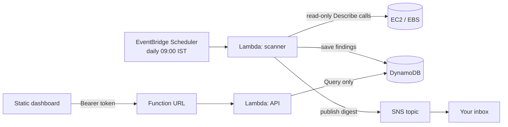

# Cloud Waste Watcher

A small, free-to-run tool that finds forgotten AWS resources that quietly cost money, and tells you about them in plain English, once a day.

> Built as a learning project: a solo developer or student forgets a disk or an IP address, and the bill grows. AWS has tools for this, but the useful ones sit behind paid support plans or are written for big companies. This one is for one person with one account.

<!-- Add a screenshot of your dashboard here:  -->

## What it does

Every morning it scans one AWS region (default: Mumbai) for:

| Check | What it flags |
|---|---|
| Unattached EBS volumes | Disks that exist but aren't connected to anything |
| Idle Elastic IPs | Public addresses not attached to anything (AWS charges for these) |
| Stopped instances | Instances stopped for 7+ days (their disks still bill) |
| Old snapshots | Snapshots older than 90 days |

Then it:
- estimates a **monthly cost** for each item (Mumbai prices where verified), in dollars and rupees
- saves the results to DynamoDB, so it can tell what is **new** from what is **still there**
- emails a digest
- serves a small dashboard with the total and a 30-scan trend

It is **read-only**: it advises and never deletes anything. Tag a resource `waste-watcher:ignore = true` to hide it on purpose.

## Architecture



## Security design

- **Two Lambdas, two roles.** The scanner can read EC2 and write to its own table and topic. The API can only run `Query` on the table. Compromising the website-facing function cannot change anything.
- **No keys in code.** Lambda receives temporary credentials through its role.
- **Least privilege.** `Describe` calls need `Resource: "*"` (AWS doesn't support narrowing them), but every action is read-only; the DynamoDB and SNS statements are locked to one table and one topic.
- **Dashboard token** is compared in constant time. It's a shared secret, fine for a personal tool; a multi-user product should use real sign-in.
- Tests use a simulated AWS with fake credentials, so they can never touch a real account. CI fails if anything that looks like an AWS access key is committed.

## Cost

Designed to stay inside the always-free allowances: Lambda (one run a day), DynamoDB provisioned mode at 5 read / 5 write units with auto scaling off, SNS email (about 30 a month), and EventBridge Scheduler. Check current AWS terms for your account before deploying, and set a zero-spend budget alert.

## Deploy

Requirements: an AWS account, the AWS CLI logged in as a **non-root** user, and [Terraform](https://developer.hashicorp.com/terraform/install).

```bash
cd terraform
cp terraform.tfvars.example terraform.tfvars   # then edit: your email and a long random token
terraform init
terraform plan        # read this: it lists everything that will be created
terraform apply
```

1. Click the confirmation link AWS emails you (until you do, no digest arrives).
2. Put the `dashboard_api_url` output into `API_URL` in `dashboard/index.html`, then host that file anywhere static (for example Cloudflare Pages). Narrow `allowed_origin` to your site's address and run `terraform apply` again.
3. To remove everything: `terraform destroy`.

`terraform.tfstate` contains your dashboard token. It is git-ignored; never commit it.

## Develop and test

```bash
python -m venv .venv && source .venv/bin/activate    # Windows: .venv\Scripts\activate
pip install -r requirements-dev.txt
pytest
```

Layout:

```
src/        checks.py (one function per kind of waste), pricing.py, scan.py, storage.py,
            digest.py, lambda_function.py (scanner), api_function.py (dashboard API)
dashboard/  index.html
terraform/  the whole stack as code
tests/      pytest suite against a simulated AWS
```

Adding a check = write one function in `checks.py`, add it to `CHECKS`, add an estimator in `pricing.py`.

## Design decisions and trade-offs

- **Detective and reporter are separate.** Checks return plain data; printing, emailing and saving happen elsewhere. That is why the same code runs on a laptop and in Lambda.
- **One failing check doesn't stop the report.** A missing permission shows up as a listed error, not a crash.
- **Honest estimates.** Unknown cost shows as "not estimated", and snapshot cost is labelled an upper bound.
- **"New vs still there"** keeps the email readable.
- **Shared-secret token instead of a login system.** Simple and adequate for one user; the main thing to replace first if this grows.

## Known limitations

- `age` for volumes is time since creation, not since detachment (that needs CloudTrail).
- Only one region per deployment.
- Prices are typed in `pricing.py`; only gp3 is verified for Mumbai, the rest are placeholders until you update them (`src/price_lookup.py` fetches real ones).
- Elastic IPs have no creation date in the API, so their age is unknown.

## Roadmap

Scan all regions, fetch prices automatically, CloudTrail-based detach dates, idle load balancers, Telegram/Slack alerts, deploy from CI using short-lived OIDC credentials instead of stored keys.
